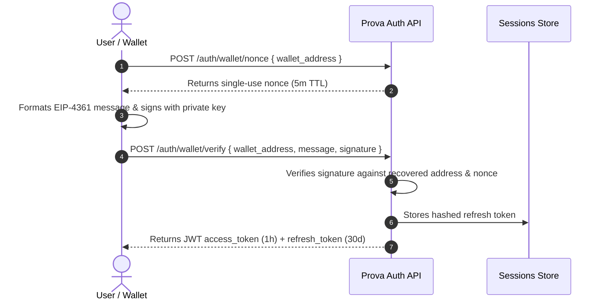

Prova supports two authentication flows: **SIWE Bearer Tokens** for interactive frontend sessions, and **OAuth 2.0 Client Credentials** for server-to-server daemon processes.

---

## 1. Interactive Sign-In with Ethereum (SIWE)

Interactive users authenticate using their Ethereum wallet ([EIP-4361](https://eips.ethereum.org/EIPS/eip-4361)) on **Arbitrum Sepolia** (Chain ID: `421614`).

### The SIWE Sequence



### Endpoints:
1. `POST /api/v1/auth/wallet/nonce`:
   ```json
   { "wallet_address": "0x742d35Cc6634C0532925a3b844Bc454e4438f44e" }
   ```
2. `POST /api/v1/auth/wallet/verify`:
   ```json
   {
     "wallet_address": "0x742d35Cc6634C0532925a3b844Bc454e4438f44e",
     "message": "pilot.getprova.trade wants you to sign in with your Ethereum account...",
     "signature": "0x1b2c3d..."
   }
   ```

### Token Lifetimes & Rotation
- **Access Token TTL:** 1 hour (`3600` seconds).
- **Refresh Token TTL:** 30 days (`2592000` seconds).
- **Hashed at Rest:** Refresh tokens are stored **SHA-256 hashed** in the database.
- **Strict Rotation:** When you exchange a refresh token via `POST /api/v1/auth/tokens/refresh`, the previous refresh token is immediately invalidated. If an old refresh token is reused, the entire session chain is revoked to prevent replay attacks.
- **Revocation / Logout:** `POST /api/v1/auth/tokens` invalidates the active session.

---

## 2. OAuth 2.0 Client Credentials

For backend microservices, ERP connectors, and automated workflows:

### 1. Minting Credentials
An authenticated user generates a client key pair:
```bash
curl -X POST https://pilot.getprova.trade/api/v1/api-credentials \
  -H "Authorization: Bearer $ACCESS_TOKEN"
```
**Response (`201 Created`):**
```json
{
  "client_id": "client_01HXYZ...",
  "client_secret": "sec_89ab...",
  "status": "ACTIVE",
  "created_at": "2026-10-20T18:00:00.000Z"
}
```
<Note type="warning" title="Store Your Secret Immediately">
  The `client_secret` is shown **only once** upon creation. It is stored using `scrypt` hashing in the database and cannot be retrieved later.
</Note>

### 2. Token Exchange
Exchange the credentials for a bearer token:
```bash
curl -X POST https://pilot.getprova.trade/api/v1/api-credentials/oauth/token \
  -H "Content-Type: application/json" \
  -d '{
    "grant_type": "client_credentials",
    "client_id": "client_01HXYZ...",
    "client_secret": "sec_89ab..."
  }'
```

---

## 3. Role-Based Access Control (RBAC) Matrix

Prova enforces **institution-scoped RBAC**. Roles are assigned per institution:

| Action | Owner | Admin | Underwriter | Viewer |
| :--- | :---: | :---: | :---: | :---: |
| Invite & remove institution members | ✓ | ✓ | — | — |
| Create and configure products | ✓ | ✓ | — | — |
| Publish insurance products | ✓ | ✓ | — | — |
| Submit policy application (get quote) | ✓ | ✓ | ✓ | — |
| Accept quote | ✓ | ✓ | ✓ | — |
| Issue policy | ✓ | ✓ | — | — |
| Activate policy (bind capital) | ✓ | ✓ | — | — |
| Amend active policy | ✓ | ✓ | ✓ | — |
| Submit claim | ✓ | ✓ | ✓ | — |
| Start claim review | ✓ | ✓ | ✓ | — |
| Approve / reject claim | ✓ | ✓ | ✓ | — |
| Request settlement & settle claim | ✓ | ✓ | — | — |
| Query buyer credit score | ✓ | ✓ | ✓ | ✓ |
| Read institution data | ✓ | ✓ | ✓ | ✓ |

---

## Common Authentication Errors

| Status Code | Error Message | Cause & Resolution |
| :--- | :--- | :--- |
| `401` | `Bearer token is required` | The `Authorization` header is missing or improperly formatted. Use `Bearer <token>`. |
| `401` | `Token verification failed` | The JWT has expired or the signature is invalid. Refresh or re-authenticate. |
| `401` | `Invalid signature` | The SIWE message signature does not match the claimed wallet address or uses an expired nonce. |
| `403` | `You are not a member of this institution` | The authenticated user does not have an active membership in the target institution. |
| `403` | `Required role: OWNER or ADMIN` | The caller's role in the institution is insufficient for the requested mutating operation. |
