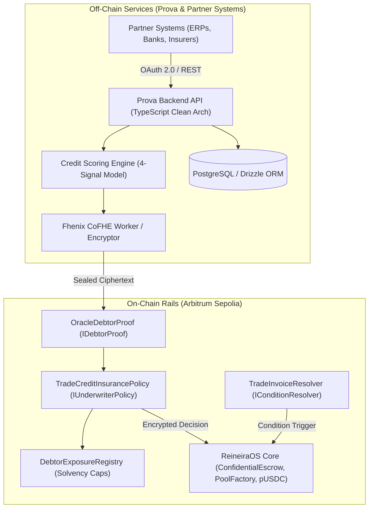

Prova bridges traditional trade credit underwriting with decentralized settlement rails on **Arbitrum Sepolia**. To build a robust integration, developers should understand Prova's architectural boundary, smart contract plugins, and confidentiality model.

---

## The Boundary Rule

Prova operates under a strict system design constraint:

> **On-chain only what requires blockchain trust** — the authority to disburse pooled liquidity, execute immutable public settlement, or enforce a tamper-proof solvency bound. **Everything the backend can be trusted to coordinate remains off-chain.**



---

## 1. Plugin Architecture (ReineiraOS Integration)

Prova is a **plugin author, not a protocol author**. Prova implements two standard Solidity interfaces defined by ReineiraOS:

### `IConditionResolver` — "When should funds release?"
Implemented by `TradeInvoiceResolver` (`contracts/src/resolvers/TradeInvoiceResolver.sol`):
- Controls the payout conditions for invoice escrows.
- Evaluates **protracted default**: a claim triggers when the invoice `dueDate` plus an agreed `waitingPeriod` has elapsed without payment.
- Enforces an immutable waiting period floor (`MIN_WAITING_PERIOD_FLOOR = 1 day`) up to `MAX_WAITING_PERIOD = 180 days` (industry standard).
- Guarantees **duplicate invoice protection**: a canonical keccak256 hash `_invoiceHash(buyer, seller, amount, dueDate)` prevents the same invoice from being insured or escrowed twice (`TradeInvoiceResolver.sol:225-232`).
- Provides an optional integration with an `IPaymentOracle` (`ManualPaymentAttestation.sol` or zkTLS) to suppress default claims if off-chain payment occurred.

### `IUnderwriterPolicy` — "How is risk scored? Is a claim valid?"
Implemented by `TradeCreditInsurancePolicy` (`contracts/src/policies/TradeCreditInsurancePolicy.sol`):
- Evaluates risk during coverage purchase and judges claims during disputes.
- Operates entirely over encrypted values using **Fhenix CoFHE** (`euint64`, `euint32`, `ebool`).
- Computes premiums by evaluating encrypted credit scores against encrypted piecewise risk curves (`encThresholds`, `encPremiums`), plus encrypted country (`countryRisk`) and industry (`industryRisk`) add-ons.
- Emits encrypted decisions (`FHE.asEuint64`, `FHE.asEbool`) that authorize ReineiraOS liquidity pools to move funds without revealing underlying trade secrets.

---

## 2. Confidential Computing with Fhenix CoFHE

In conventional smart contracts, all state variables and inputs are readable by anyone examining the blockchain. Prova avoids leaking corporate financial data by using **Fully Homomorphic Encryption (FHE)** via the Fhenix CoFHE coprocessor:

1. **Sealed Inputs:** Buyer credit scores, debtor exposure limits, and premium curve parameters exist on-chain only as opaque ciphertext handles (`euint32`, `euint64`).
2. **Encrypted Evaluation:** Risk pricing is calculated using homomorphic operations (comparisons, additions, and selects) directly on ciphertexts.
3. **Access Control Lists (ACL):** When a contract calculates an encrypted value, it calls:
   ```solidity
   FHE.allowThis(encryptedValue);       // Grants this contract access
   FHE.allow(encryptedValue, caller);   // Grants the calling protocol access
   ```
   Plaintext is never exposed to node validators, blockchain indexers, or competitors.

---

## 3. The 4-Signal Off-Chain Credit Model

Risk scoring is computed off-chain by the Prova backend service (`ComputeCreditScoreUseCase`) and lands on-chain as an encrypted handle via `OracleDebtorProof`:

- **Signal 1 — Payment Rate (0–400 points):** Historical ratio of settled escrows to total escrows for the counterparty.
- **Signal 2 — Days Sales Outstanding / DSO (0–300 points):** Average time between invoice due date and actual settlement timestamp.
- **Signal 3 — Settled Volume (0–150 points):** Total transaction volume successfully settled, normalized up to a 150-point ceiling.
- **Signal 4 — Default Rate Penalty (0–100 points):** Negative penalty proportional to previous expired or failed escrows.

The resulting score (0 to 950 points; 500 for unrecorded buyers) is encrypted into a CoFHE ciphertext and signed by the Prova backend with a 15-minute time-to-live.

---

## 4. Solvency Guardrail (`DebtorExposureRegistry`)

To prevent over-leveraging and catastrophic insolvency:
- The `DebtorExposureRegistry` contract tracks aggregate insured exposure per buyer debtor across **all underwriting pools simultaneously**.
- Concentration caps are evaluated inside FHE using `FHE.select` on the encrypted comparison between cumulative exposure and the debtor's maximum cap.
- **Pool-splitting prevention:** Because the limit is enforced globally against the aggregate total, bad actors cannot bypass concentration limits by creating multiple smaller pools.

---

## 5. Deployed Contract Reference (Arbitrum Sepolia)

| Contract | Address | Network |
| :--- | :--- | :--- |
| **ConfidentialEscrow** (Reineira Core) | `0xC4333F84F5034D8691CB95f068def2e3B6DC60Fa` | Arbitrum Sepolia |
| **ConfidentialCoverageManager** | `0x766e9508BD41BCE0e788F16Da86B3615386Ff6f6` | Arbitrum Sepolia |
| **PoolFactory** | `0x03bAc36d45fA6f5aD8661b95D73452b3BedcaBFD` | Arbitrum Sepolia |
| **PolicyRegistry** | `0xf421363B642315BD3555dE2d9BD566b7f9213c8E` | Arbitrum Sepolia |
| **cUSDC** (Confidential USDC) | `0x6b6e6479b8b3237933c3ab9d8be969862d4ed89f` | Arbitrum Sepolia |
| **USDC** (Testnet USDC) | `0x75faf114eafb1BDbe2F0316DF893fd58CE46AA4d` | Arbitrum Sepolia |

---

## Next Steps

- Learn how to create and fund [Invoice Escrows](/guides/invoice-escrows).
- Follow the institutional [Policy Lifecycle](/guides/policy-lifecycle).
- Review [Credit Scoring & Risk Proofs](/guides/credit-scoring).
