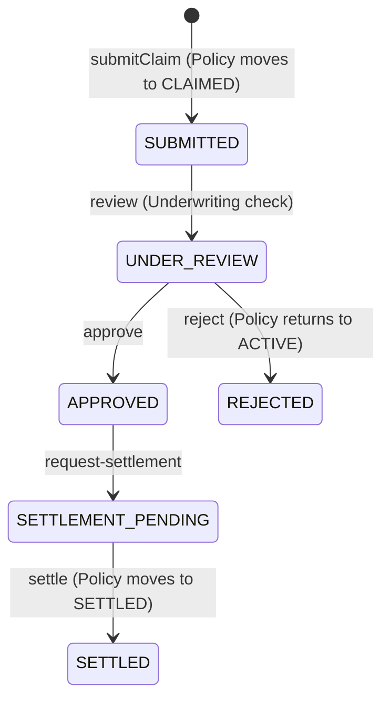

Trade-credit insurance protects suppliers against commercial non-payment caused by buyer insolvency or protracted default. Prova provides a structured claims lifecycle with built-in fraud prevention and settlement coordination.

---

## Claim Lifecycle State Machine



---

## Protracted Default Trigger Rules

In Prova, claims are governed by the `TradeInvoiceResolver` smart contract:
1. **Maturity & Grace:** A claim may only be filed once the invoice due date plus the waiting period has elapsed (`block.timestamp >= dueDate + waitingPeriod`).
2. **Waiting Period Window:** Bounded between `1 day` (anti-gaming floor) and `180 days` (standard industry ceiling). Defaults to `30 days`.
3. **Payment Truth Check:** If a payment oracle (`IPaymentOracle`) is configured and records that the buyer paid off-chain, the condition resolution suppresses the claim (`TradeInvoiceResolver.sol:261-267`).

---

## Step 1: Submit a Claim

When a protracted default occurs, submit a claim against an `ACTIVE` policy:

```bash
curl -X POST https://pilot.getprova.trade/api/v1/institutions/inst_12345/claims \
  -H "Authorization: Bearer $ACCESS_TOKEN" \
  -H "Content-Type: application/json" \
  -d '{
    "policy_id": "pol_abc123",
    "claimant": "SELLER-NG-001",
    "reason": "Protracted default: buyer failed to settle within 30-day grace period",
    "amount": 45000,
    "evidence": [
      "ipfs://bafybeigdyrzt5sfp7udm7hu76uh7y26nf3efuylqabf3oclgtqy55fbzdi/invoice-0089.pdf",
      "ipfs://bafybeigdyrzt5sfp7udm7hu76uh7y26nf3efuylqabf3oclgtqy55fbzdi/demand-notice.pdf"
    ]
  }'
```

### Effects:
- Creates a new claim record with status `SUBMITTED`.
- Automatically transitions the parent policy from `ACTIVE` to `CLAIMED`.
- Reverts with `409 Conflict` if the policy is not in `ACTIVE` state or another claim is already open.

---

## Step 2: Underwriting Review & Adjudication

An underwriter reviews the supporting documentation:

### 1. Start Review
Authorized roles: `OWNER`, `ADMIN`, `UNDERWRITER`
```bash
curl -X POST https://pilot.getprova.trade/api/v1/institutions/inst_12345/claims/clm_xyz789/review \
  -H "Authorization: Bearer $ACCESS_TOKEN"
```
Claim status transitions to `UNDER_REVIEW`.

### 2. Decision: Approve or Reject

#### Option A: Approve Claim
```bash
curl -X POST https://pilot.getprova.trade/api/v1/institutions/inst_12345/claims/clm_xyz789/approve \
  -H "Authorization: Bearer $ACCESS_TOKEN"
```
Claim status transitions to `APPROVED`.

#### Option B: Reject Claim
```bash
curl -X POST https://pilot.getprova.trade/api/v1/institutions/inst_12345/claims/clm_xyz789/reject \
  -H "Authorization: Bearer $ACCESS_TOKEN"
```
Claim status transitions to `REJECTED` (terminal). The parent policy transitions from `CLAIMED` back to `ACTIVE`.

---

## Step 3: Settlement Coordination

Once a claim is approved, settlement operations coordinate capital release from the underwriting liquidity pool:

### 1. Request Settlement
Authorized roles: `OWNER`, `ADMIN`
```bash
curl -X POST https://pilot.getprova.trade/api/v1/institutions/inst_12345/claims/clm_xyz789/request-settlement \
  -H "Authorization: Bearer $ACCESS_TOKEN"
```
Claim status transitions to `SETTLEMENT_PENDING`.

### 2. Settle the Claim
Once capital has moved on-chain (or payout is verified), finalize the claim:
```bash
curl -X POST https://pilot.getprova.trade/api/v1/institutions/inst_12345/claims/clm_xyz789/settle \
  -H "Authorization: Bearer $ACCESS_TOKEN"
```

### Effects:
- Claim status transitions to `SETTLED`.
- Parent policy transitions to `SETTLED`.
- Emits settlement event and records transaction identifier for post-settlement audits.

---

## Disputed Debts & Arbitration

Trade credit insurance policies strictly exclude disputed invoices from default coverage. If a buyer challenges quality or delivery before default:

1. **File a Trade Dispute:**
   ```bash
   curl -X POST https://pilot.getprova.trade/api/v1/disputes \
     -H "Authorization: Bearer $ACCESS_TOKEN" \
     -H "Content-Type: application/json" \
     -d '{
       "escrow_public_id": "esc_550e8400-e29b-41d4-a716-446655440000",
       "dispute_proof": "0x789abc..."
     }'
   ```
2. **Record Dispute Judgment (Admin Only):**
   ```bash
   curl -X POST https://pilot.getprova.trade/api/v1/disputes/disp_123/resolve \
     -H "Authorization: Bearer $ACCESS_TOKEN" \
     -H "Content-Type: application/json" \
     -d '{
       "accepted": true,
       "tx_hash": "0x456def..."
     }'
   ```
   The dispute is committed to the on-chain `DisputeAttestation` oracle, preventing fraudulent default claims against actively contested trade debt.
