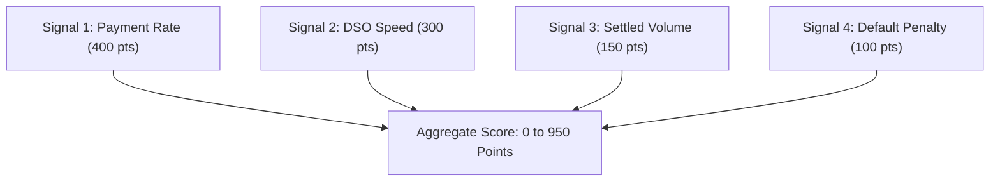

Prova evaluates counterparty credit risk using a **4-signal off-chain credit model**. The resulting score is encrypted into an opaque Fhenix CoFHE ciphertext before it touches the blockchain, allowing smart contracts to price risk homomorphically without exposing buyer financial scores.

---

## The 4-Signal Scoring Algorithm

The Prova backend evaluates historical settled escrows for the counterparty wallet address across four primary dimensions:



### Signal 1: Payment Rate (0–400 points)
Measures the historical reliability of the buyer in settling matured escrows:
- `Payment Rate = Settled Escrows / Total Escrows`
- `Signal 1 Score = round(Payment Rate * 400)`

### Signal 2: Days Sales Outstanding / DSO (0–300 points)
Measures payment speed relative to the agreed invoice deadline. Let `deltaDays = settledAt - deadline`:
- Paid early or on time (`deltaDays <= 0`): **300 points**.
- Paid within 15 days grace (`deltaDays <= 15`): **220 points**.
- Paid within 30 days grace (`deltaDays <= 30`): **140 points**.
- Paid within 60 days grace (`deltaDays <= 60`): **60 points**.
- Paid after 60+ days: **0 points**.

### Signal 3: Cumulative Settled Volume (0–150 points)
Rewards verified volume capacity, capped at \$100,000 equivalent for the maximum score:
- `Volume Score = min(round((Total Volume / 100000) * 150), 150)`

### Signal 4: Default Penalty (0–100 points)
Penalizes counterparties with expired, disputed, or defaulted escrows:
- `Default Rate = Expired or Failed Escrows / Total Escrows`
- `Signal 4 Score = round((1 - Default Rate) * 100)`

### Neutral Initial Score
If a buyer has no recorded history on Prova, the scoring engine assigns a **neutral default score of 500 points**.

---

## Fetching Credit Scores via API

Call `GET /api/v1/credit-score/:buyerAddress`:

```bash
curl https://pilot.getprova.trade/api/v1/credit-score/0x1111111254fb6c44bac0bed2854e76f90643097d \
  -H "Authorization: Bearer $ACCESS_TOKEN"
```

### Response (`200 OK`)

```json
{
  "buyer_address": "0x1111111254fb6c44bac0bed2854e76f90643097d",
  "raw_score": 740,
  "risk_proof": "0x04000000000002e48f...",
  "expires_at": 1792518900
}
```

- `raw_score`: Integer from 0 to 950.
- `risk_proof`: CoFHE-formatted ciphertext encoding the score as an `InEuint32` payload signed by the Prova oracle.
- `expires_at`: UNIX epoch timestamp (seconds). Risk proofs carry a strict **15-minute TTL**.

---

## On-Chain Verification (`OracleDebtorProof.sol`)

The `risk_proof` is submitted by the oracle to `OracleDebtorProof.sol` on Arbitrum Sepolia:

```solidity
function setScore(bytes32 debtorId, InEuint32 calldata inScore) external onlyOracle {
    // 1. Verify ciphertext format (EUINT32_UTYPE = 4)
    if (inScore.utype != EUINT32_UTYPE) revert InvalidCiphertextType(EUINT32_UTYPE, inScore.utype);
    if (inScore.ctHash == bytes32(0)) revert InvalidCiphertextZeroHash();
    if (inScore.signature.length == 0) revert InvalidCiphertextEmptySignature();

    // 2. Validate ciphertext through CoFHE TaskManager
    euint32 score = FHE.asEuint32(inScore);
    FHE.allowThis(score);

    // 3. Store score with timestamp
    scores[debtorId] = StoredScore({
        score: score,
        timestamp: block.timestamp,
        set: true
    });
}
```

### Staleness Protection
When `TradeCreditInsurancePolicy` evaluates coverage, it verifies that the attested score has not exceeded `maxScoreStaleness`:
```solidity
if (maxStaleness > 0 && block.timestamp - scoreTimestamp > maxStaleness) {
    revert StaleOracleScore(scoreTimestamp, block.timestamp, maxStaleness);
}
```
If a score is older than the configured threshold, policy issuance reverts immediately, preventing the use of expired credit assessments.
