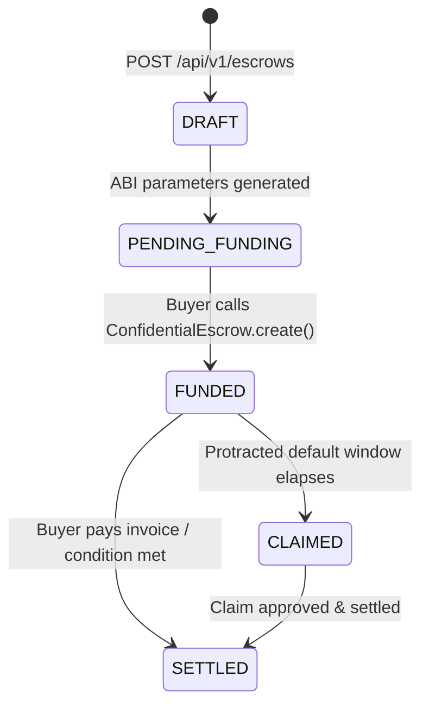

In Prova, receivables are locked into programmatic invoice escrows governed by `ConfidentialEscrow` and `TradeInvoiceResolver`. Escrows guarantee that buyer payments release to the seller upon maturity or unlock claim rights if protracted default occurs.

## Overview of the Escrow Lifecycle



---

## Step 1: Create an Escrow via the API

Call `POST /api/v1/escrows` to register the invoice terms and generate on-chain ABI call parameters:

```bash
curl -X POST https://pilot.getprova.trade/api/v1/escrows \
  -H "Authorization: Bearer $ACCESS_TOKEN" \
  -H "Content-Type: application/json" \
  -H "x-encryption-mode: server" \
  -d '{
    "type": "INVOICE",
    "amount": 25000,
    "currency": {
      "type": "crypto",
      "code": "USDC"
    },
    "counterparty": "0x1111111254fb6c44bac0bed2854e76f90643097d",
    "deadline": "2026-12-31",
    "external_reference": "INV-2026-0042",
    "resolver_address": "0xYourDeployedTradeInvoiceResolverAddress"
  }'
```

### Encryption Modes (`x-encryption-mode`)
- **`server` (default):** Prova encrypts the owner address and amount into FHE ciphertexts on your behalf using the backend FHE service.
- **`client`:** The API returns unencrypted parameters (`amount_smallest_unit`, `owner_address`), allowing your frontend or client SDK to encrypt values locally using `@cofhe/sdk` before submitting to the blockchain.

### Response (`201 Created`)

```json
{
  "public_id": "esc_550e8400-e29b-41d4-a716-446655440000",
  "contract_address": "0xC4333F84F5034D8691CB95f068def2e3B6DC60Fa",
  "abi_function_signature": "create((string,number,number,string),(string,number,number,string),address,bytes)",
  "abi_parameters": {
    "encrypted_owner": ["0x9a8b...", 1, 4, "0xsignature..."],
    "encrypted_amount": ["0x7c6d...", 1, 4, "0xsignature..."],
    "resolver": "0xYourDeployedTradeInvoiceResolverAddress",
    "resolver_data": "0x000000000000000000000000..."
  }
}
```

---

## Step 2: Submit the On-Chain Transaction

The buyer (or funding party) invokes `create()` on the `ConfidentialEscrow` contract on Arbitrum Sepolia using the `abi_parameters` returned by the API:

```typescript
import { createWalletClient, custom } from 'viem';
import { arbitrumSepolia } from 'viem/chains';

const escrowAbi = [
  {
    name: 'create',
    type: 'function',
    stateMutability: 'nonpayable',
    inputs: [
      {
        name: 'owner',
        type: 'tuple',
        components: [
          { name: 'ctHash', type: 'bytes32' },
          { name: 'securityZone', type: 'uint8' },
          { name: 'utype', type: 'uint8' },
          { name: 'signature', type: 'bytes' },
        ],
      },
      {
        name: 'amount',
        type: 'tuple',
        components: [
          { name: 'ctHash', type: 'bytes32' },
          { name: 'securityZone', type: 'uint8' },
          { name: 'utype', type: 'uint8' },
          { name: 'signature', type: 'bytes' },
        ],
      },
      { name: 'resolver', type: 'address' },
      { name: 'resolverData', type: 'bytes' },
    ],
    outputs: [{ name: 'escrowId', type: 'uint256' }],
  },
] as const;

const hash = await walletClient.writeContract({
  address: response.contract_address,
  abi: escrowAbi,
  functionName: 'create',
  args: [
    response.abi_parameters.encrypted_owner,
    response.abi_parameters.encrypted_amount,
    response.abi_parameters.resolver,
    response.abi_parameters.resolver_data,
  ],
});

console.log('Escrow created on-chain. Transaction hash:', hash);
```

---

## Step 3: Report the Funding Transaction

Once the transaction is submitted, notify the Prova backend:

```bash
curl -X POST https://pilot.getprova.trade/api/v1/transactions/escrows/report \
  -H "Authorization: Bearer $ACCESS_TOKEN" \
  -H "Content-Type: application/json" \
  -d '{
    "public_id": "esc_550e8400-e29b-41d4-a716-446655440000",
    "tx_hash": "0xabcdef1234567890abcdef1234567890abcdef1234567890abcdef1234567890"
  }'
```

Additionally, Prova's inbound QuickNode webhook will observe the `EscrowCreated` event on Arbitrum Sepolia and update the escrow status automatically.

---

## Step 4: Query Escrow Status

Retrieve the updated escrow record:

```bash
curl https://pilot.getprova.trade/api/v1/escrows/esc_550e8400-e29b-41d4-a716-446655440000 \
  -H "Authorization: Bearer $ACCESS_TOKEN"
```

**Response (`200 OK`):**
```json
{
  "public_id": "esc_550e8400-e29b-41d4-a716-446655440000",
  "type": "INVOICE",
  "amount": 25000,
  "currency": { "type": "crypto", "code": "USDC" },
  "status": "FUNDED",
  "on_chain_id": "14",
  "tx_hash": "0xabcdef1234567890...",
  "counterparty": "0x1111111254fb6c44bac0bed2854e76f90643097d",
  "deadline": "2026-12-31",
  "external_reference": "INV-2026-0042",
  "resolver_address": "0xYourDeployedTradeInvoiceResolverAddress",
  "created_at": "2026-10-20T18:05:00.000Z"
}
```

---

## Duplicate Invoice Protection

The `TradeInvoiceResolver` contract enforces duplicate detection on-chain:
```solidity
bytes32 hash = keccak256(abi.encode(buyer, seller, invoiceAmount, dueDate));
if ($.invoiceRegistered[hash]) revert InvoiceAlreadyRegistered(hash);
```
If an attempt is made to create a second escrow with identical counterparty addresses, face amount, and due date, the transaction reverts with `InvoiceAlreadyRegistered`.
