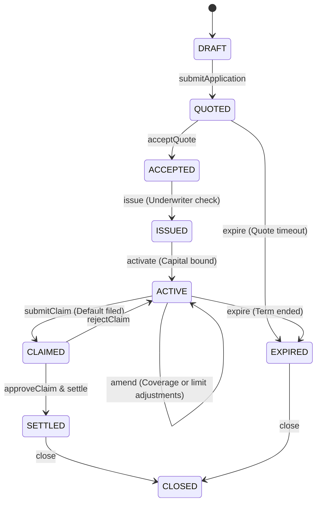

Prova provides a state-machine driven policy lifecycle for institutional underwriters. Every policy transition is recorded in an immutable audit ledger with cryptographic versioning.

---

## Policy State Machine



<Note type="warning" title="Enforced State Transitions">
  Any transition not defined in the state machine returns `409 Conflict` (for example, attempting to `issue` directly from `QUOTED` without `acceptQuote`). Illegal transitions are safe: they mutate no state and produce no audit entries.
</Note>

---

## Step 1: Create and Publish an Insurance Product

Before issuing policies, an institution defines a trade-credit insurance product:

### 1. Create a Draft Product
```bash
curl -X POST https://pilot.getprova.trade/api/v1/institutions/inst_12345/products \
  -H "Authorization: Bearer $ACCESS_TOKEN" \
  -H "Content-Type: application/json" \
  -d '{
    "name": "West Africa Single-Invoice Export Protection",
    "coverage_type": "SINGLE_INVOICE",
    "currency": "USDC",
    "jurisdictions": ["NG", "GH", "KE"]
  }'
```

### 2. Configure Underwriting Rules & Limits
Configure the product's premium curve, risk parameters, and waiting periods:
```bash
curl -X POST https://pilot.getprova.trade/api/v1/institutions/inst_12345/products/prd_67890/config \
  -H "Authorization: Bearer $ACCESS_TOKEN" \
  -H "Content-Type: application/json" \
  -d '{
    "min_coverage_pct_bps": 7000,
    "max_coverage_pct_bps": 9500,
    "min_waiting_period_days": 30,
    "max_waiting_period_days": 180,
    "base_premium_bps": 200,
    "max_credit_limit": 500000
  }'
```

### 3. Publish the Product
```bash
curl -X POST https://pilot.getprova.trade/api/v1/institutions/inst_12345/products/prd_67890/publish \
  -H "Authorization: Bearer $ACCESS_TOKEN"
```
The product is now `PUBLISHED` and can accept policy applications.

---

## Step 2: Submit a Policy Application (Quotation)

Submit an application on behalf of a seller for an invoice receivable:

```bash
curl -X POST https://pilot.getprova.trade/api/v1/institutions/inst_12345/policies \
  -H "Authorization: Bearer $ACCESS_TOKEN" \
  -H "Content-Type: application/json" \
  -d '{
    "product_id": "prd_67890",
    "applicant_ref": "SELLER-NG-001",
    "buyer_ref": "BUYER-0x1111111254fb6c44bac0bed2854e76f90643097d",
    "invoice_ref": "INV-2026-0089",
    "requested_amount": 50000,
    "requested_coverage_pct_bps": 9000
  }'
```

### Response (`201 Created`)
The policy enters the `QUOTED` state with the generated pricing terms:

```json
{
  "id": "pol_abc123",
  "institution_id": "inst_12345",
  "product_id": "prd_67890",
  "status": "QUOTED",
  "applicant_ref": "SELLER-NG-001",
  "buyer_ref": "BUYER-0x1111111254fb6c44bac0bed2854e76f90643097d",
  "invoice_ref": "INV-2026-0089",
  "coverage": {
    "coverage_limit": 45000,
    "coverage_pct_bps": 9000,
    "currency": "USDC"
  },
  "quote": {
    "premium_bps": 240,
    "waiting_period_days": 30,
    "expires_at": "2026-10-27T18:00:00.000Z"
  },
  "created_at": "2026-10-20T18:15:00.000Z"
}
```

---

## Step 3: Accept, Issue, and Activate

The underwriting team advances the policy through the required approvals:

### 1. Accept Quote
Authorized roles: `OWNER`, `ADMIN`, `UNDERWRITER`
```bash
curl -X POST https://pilot.getprova.trade/api/v1/institutions/inst_12345/policies/pol_abc123/accept \
  -H "Authorization: Bearer $ACCESS_TOKEN"
```
Status updates to `ACCEPTED`.

### 2. Issue Policy
Authorized roles: `OWNER`, `ADMIN`
```bash
curl -X POST https://pilot.getprova.trade/api/v1/institutions/inst_12345/policies/pol_abc123/issue \
  -H "Authorization: Bearer $ACCESS_TOKEN"
```
Status updates to `ISSUED`.

### 3. Activate Policy
Authorized roles: `OWNER`, `ADMIN`
```bash
curl -X POST https://pilot.getprova.trade/api/v1/institutions/inst_12345/policies/pol_abc123/activate \
  -H "Authorization: Bearer $ACCESS_TOKEN"
```
Status updates to `ACTIVE`. The policy is bound and provides active coverage.

---

## Step 4: Amend an Active Policy

When risk profiles change, an active policy can be amended. Authorized roles: `OWNER`, `ADMIN`, `UNDERWRITER`.

```bash
curl -X POST https://pilot.getprova.trade/api/v1/institutions/inst_12345/policies/pol_abc123/amend \
  -H "Authorization: Bearer $ACCESS_TOKEN" \
  -H "Content-Type: application/json" \
  -d '{
    "coverage": {
      "coverage_limit": 40000,
      "coverage_pct_bps": 8000,
      "currency": "USDC"
    },
    "premium_bps": 280,
    "waiting_period_days": 45,
    "reason": "Quarterly portfolio risk adjustment for buyer concentration"
  }'
```

---

## Step 5: Inspect Immutable Audit History

Every state change and amendment writes an append-only audit record:

```bash
curl https://pilot.getprova.trade/api/v1/institutions/inst_12345/policies/pol_abc123/versions \
  -H "Authorization: Bearer $ACCESS_TOKEN"
```

**Response (`200 OK`):**
```json
[
  {
    "version": 1,
    "previous_status": "DRAFT",
    "new_status": "QUOTED",
    "command": "submitApplication",
    "actor_user_id": "usr_underwriter_1",
    "created_at": "2026-10-20T18:15:00.000Z"
  },
  {
    "version": 2,
    "previous_status": "QUOTED",
    "new_status": "ACCEPTED",
    "command": "acceptQuote",
    "actor_user_id": "usr_underwriter_1",
    "created_at": "2026-10-20T18:16:00.000Z"
  },
  {
    "version": 3,
    "previous_status": "ACCEPTED",
    "new_status": "ISSUED",
    "command": "issue",
    "actor_user_id": "usr_admin_1",
    "created_at": "2026-10-20T18:17:00.000Z"
  },
  {
    "version": 4,
    "previous_status": "ISSUED",
    "new_status": "ACTIVE",
    "command": "activate",
    "actor_user_id": "usr_admin_1",
    "created_at": "2026-10-20T18:18:00.000Z"
  },
  {
    "version": 5,
    "previous_status": "ACTIVE",
    "new_status": "ACTIVE",
    "command": "amend",
    "actor_user_id": "usr_underwriter_1",
    "created_at": "2026-10-20T18:25:00.000Z"
  }
]
```
